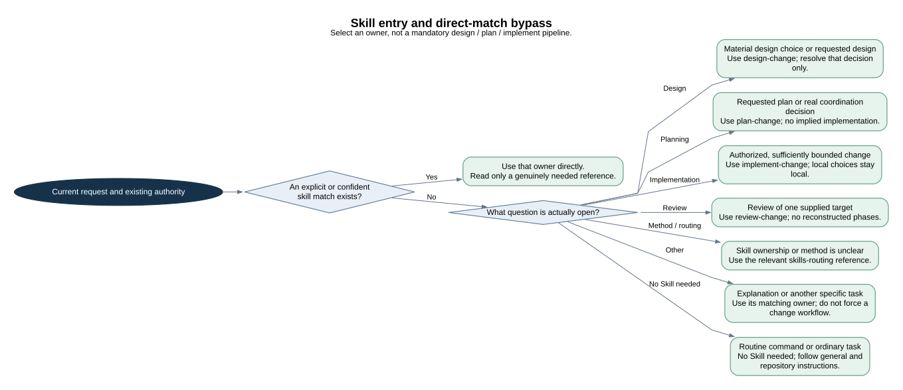
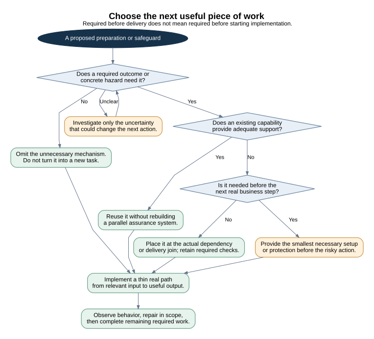
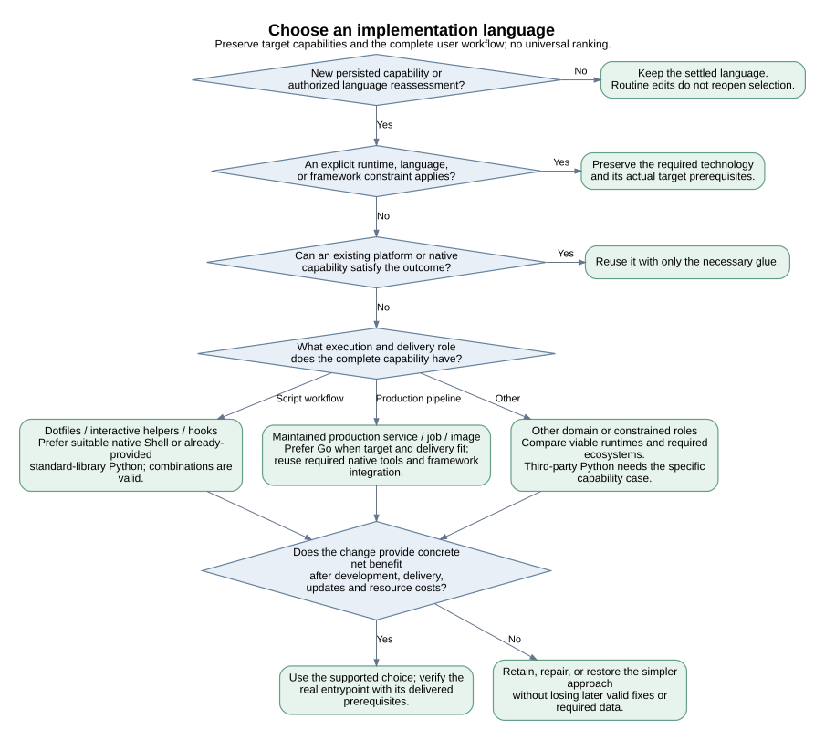
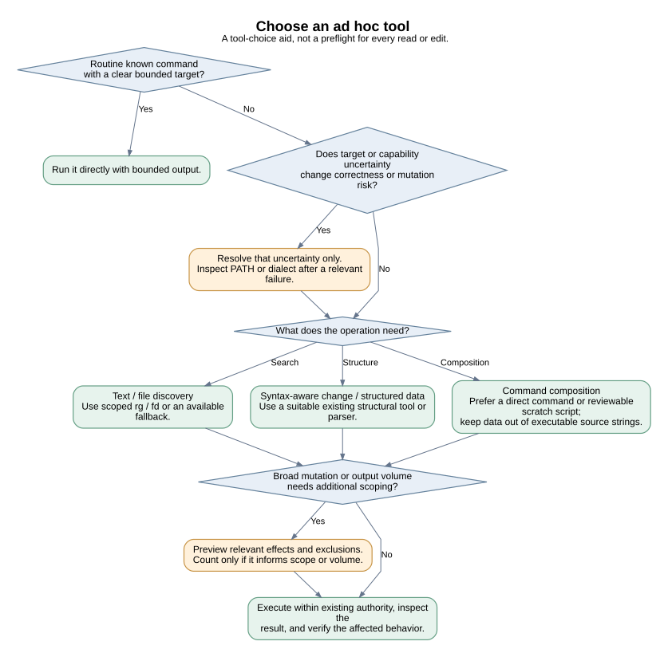
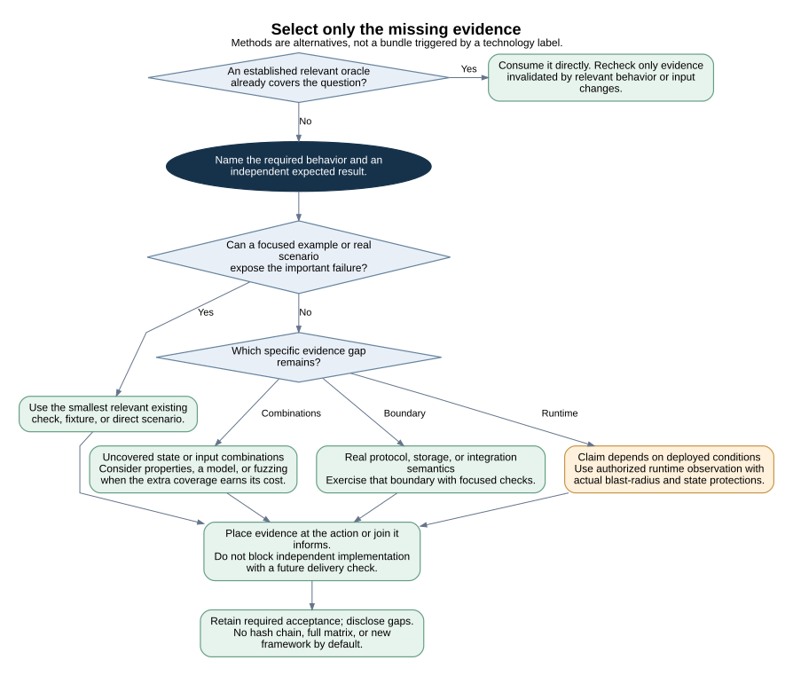
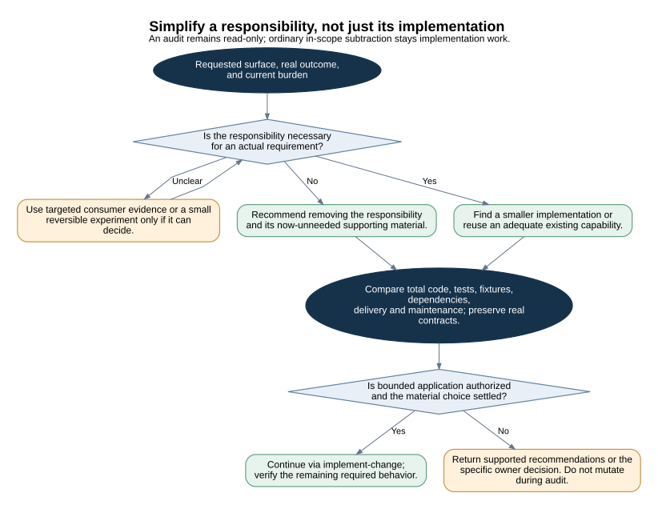
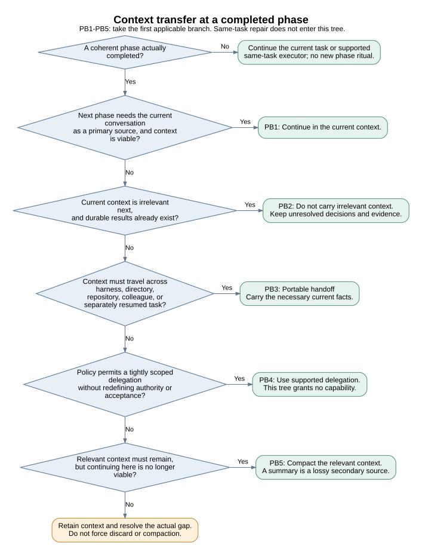
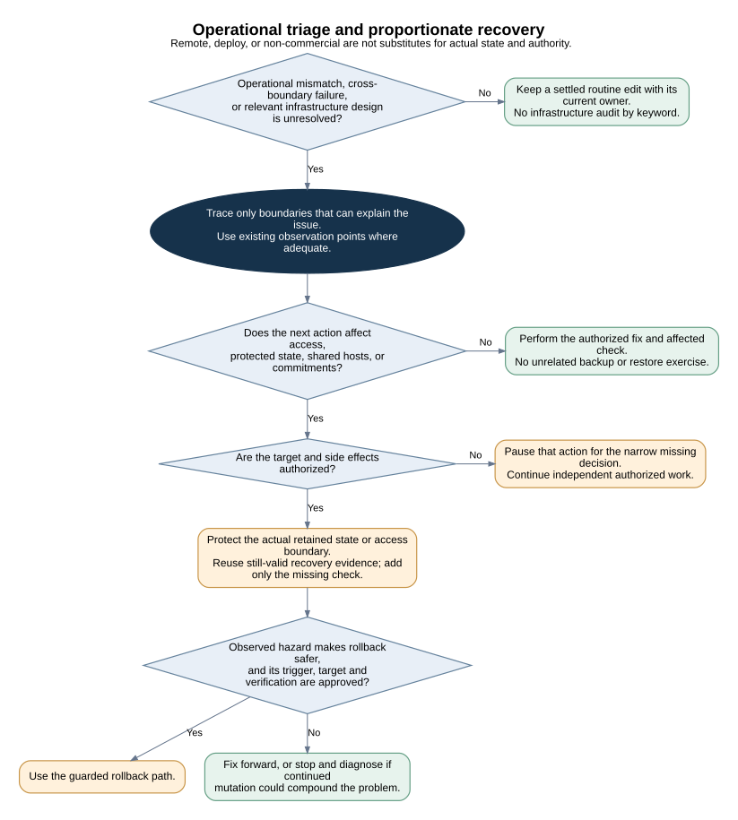
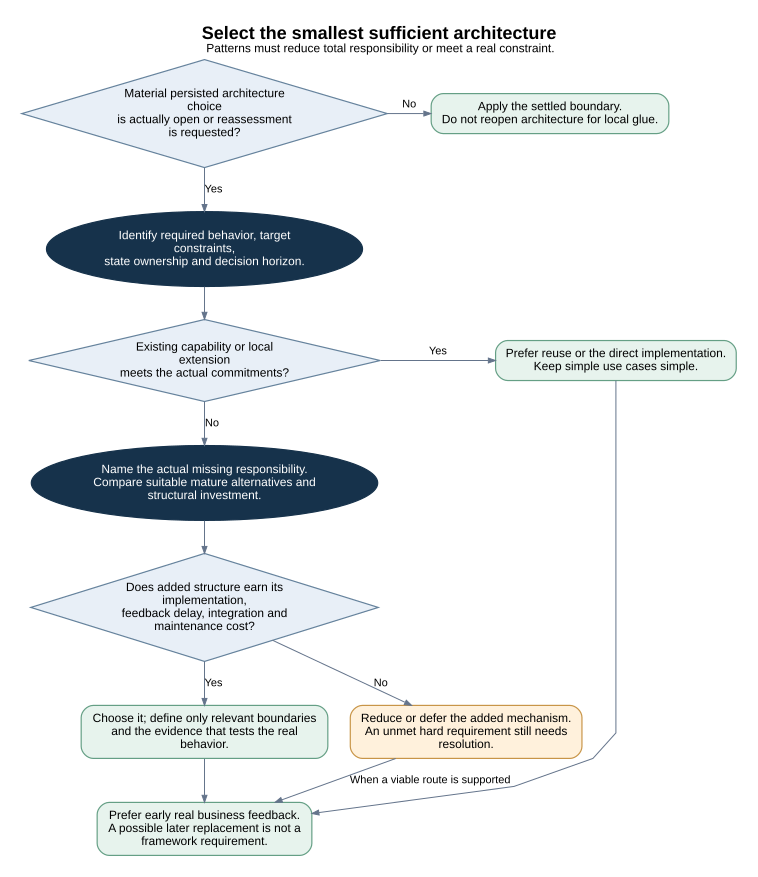
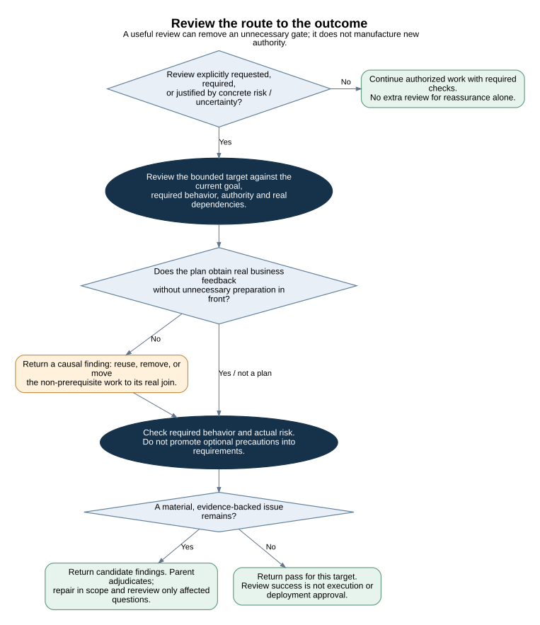

# Decision Guidance

These are reader-facing maps for checking discovery boundaries and conditional decisions. The owning Skill or reference remains the method source. Diagrams neither dispatch agents nor create a new lifecycle, permission, gate, or required report. Read only the map relevant to the question; do not traverse the gallery as a workflow.

The decision-tree methods are currently references under `skills-routing`, not new public Skills. Installed Skills do not depend on these maintenance diagrams.

## Map Index

| Map | Owning method | Main boundary |
| --- | --- | --- |
| [Skill entry and direct-match bypass](#skill-entry) | [skills/skills-routing/SKILL.md](../../skills/skills-routing/SKILL.md), [skills/design-change/SKILL.md](../../skills/design-change/SKILL.md), [skills/plan-change/SKILL.md](../../skills/plan-change/SKILL.md), [skills/implement-change/SKILL.md](../../skills/implement-change/SKILL.md) | An explicit or confident match bypasses the router. Choosing a method reference does not reopen design or planning, and a request that needs no Skill proceeds without one. |
| [Choose the next useful piece of work](#business-feedback) | [skills/development-standards/SKILL.md](../../skills/development-standards/SKILL.md), [skills/plan-change/SKILL.md](../../skills/plan-change/SKILL.md), [skills/implement-change/SKILL.md](../../skills/implement-change/SKILL.md) | Omit unsupported machinery, reuse adequate capabilities, and distinguish a current prerequisite from a later required check. The first useful slice is not the entire acceptance result. |
| [Choose an implementation language](#language-selection) | [skills/skills-routing/references/language-selection.md](../../skills/skills-routing/references/language-selection.md) | Summarizes the existing language method without changing its policy. Explicit frameworks and actual target constraints come first; the role-specific Shell/Python/Go preferences are not universal rankings. |
| [Choose an ad hoc tool](#tool-selection) | [skills/skills-routing/references/tool-selection.md](../../skills/skills-routing/references/tool-selection.md) | Routine bounded commands run directly. Counting, previewing, and tool discovery are conditional aids, not a mandatory three-step ceremony. |
| [Select only the missing evidence](#oracle-selection) | [skills/skills-routing/references/oracle-selection.md](../../skills/skills-routing/references/oracle-selection.md), [skills/testing-strategy/SKILL.md](../../skills/testing-strategy/SKILL.md) | Start from the claim and the missing failure evidence. Choose an adequate small check before adding models, fault injection, or a new fixture framework. |
| [Simplify a responsibility, not just its implementation](#simplification) | [skills/skills-routing/references/simplification.md](../../skills/skills-routing/references/simplification.md), [skills/development-standards/SKILL.md](../../skills/development-standards/SKILL.md) | Necessity precedes implementation quality. A targeted experiment is an option for uncertainty, not a required ablation stage. An audit does not grant mutation authority. |
| [Context transfer at a completed phase](#phase-boundary) | [skills/skills-routing/references/phase-boundary-decision-tree.md](../../skills/skills-routing/references/phase-boundary-decision-tree.md) | Preserves the existing PB1-PB5 order. Same-task repair and compaction are not new completed phases; an unavailable branch does not grant a new capability. |
| [Operational triage and proportionate recovery](#operational-recovery) | [skills/infrastructure-triage/SKILL.md](../../skills/infrastructure-triage/SKILL.md), [skills/testing-strategy/SKILL.md](../../skills/testing-strategy/SKILL.md) | Investigate the observed mismatch rather than every infrastructure axis. Protect actual data, access and shared resources; remote/deploy wording alone does not schedule a restore drill. |
| [Select the smallest sufficient architecture](#architecture-selection) | [skills/architecture-patterns/SKILL.md](../../skills/architecture-patterns/SKILL.md), [skills/design-change/SKILL.md](../../skills/design-change/SKILL.md) | Compare reuse, a local solution, and warranted structural investment by current commitments and total cost, including delayed feedback. A missing hard requirement is not permission to ship less. |
| [Review the route to the outcome](#review-and-progress) | [skills/review-plan/SKILL.md](../../skills/review-plan/SKILL.md), [skills/plan-change/SKILL.md](../../skills/plan-change/SKILL.md), [skills/design-change/SKILL.md](../../skills/design-change/SKILL.md) | Includes unnecessary preparation in review judgment without creating another review stage. Parent adjudication, required acceptance and actual authority remain distinct. |

## Skill Entry

Skill entry and direct-match bypass

An explicit or confident match bypasses the router. Choosing a method reference does not reopen design or planning, and a request that needs no Skill proceeds without one.



[Editable DOT source](diagrams/decisions/skill-entry.dot)

## Business Feedback

Choose the next useful piece of work

Omit unsupported machinery, reuse adequate capabilities, and distinguish a current prerequisite from a later required check. The first useful slice is not the entire acceptance result.



[Editable DOT source](diagrams/decisions/business-feedback.dot)

## Language Selection

Choose an implementation language

Summarizes the existing language method without changing its policy. Explicit frameworks and actual target constraints come first; the role-specific Shell/Python/Go preferences are not universal rankings.



[Editable DOT source](diagrams/decisions/language-selection.dot)

## Tool Selection

Choose an ad hoc tool

Routine bounded commands run directly. Counting, previewing, and tool discovery are conditional aids, not a mandatory three-step ceremony.



[Editable DOT source](diagrams/decisions/tool-selection.dot)

## Oracle Selection

Select only the missing evidence

Start from the claim and the missing failure evidence. Choose an adequate small check before adding models, fault injection, or a new fixture framework.



[Editable DOT source](diagrams/decisions/oracle-selection.dot)

## Simplification

Simplify a responsibility, not just its implementation

Necessity precedes implementation quality. A targeted experiment is an option for uncertainty, not a required ablation stage. An audit does not grant mutation authority.



[Editable DOT source](diagrams/decisions/simplification.dot)

## Phase Boundary

Context transfer at a completed phase

Preserves the existing PB1-PB5 order. Same-task repair and compaction are not new completed phases; an unavailable branch does not grant a new capability.



[Editable DOT source](diagrams/decisions/phase-boundary.dot)

## Operational Recovery

Operational triage and proportionate recovery

Investigate the observed mismatch rather than every infrastructure axis. Protect actual data, access and shared resources; remote/deploy wording alone does not schedule a restore drill.



[Editable DOT source](diagrams/decisions/operational-recovery.dot)

## Architecture Selection

Select the smallest sufficient architecture

Compare reuse, a local solution, and warranted structural investment by current commitments and total cost, including delayed feedback. A missing hard requirement is not permission to ship less.



[Editable DOT source](diagrams/decisions/architecture-selection.dot)

## Review And Progress

Review the route to the outcome

Includes unnecessary preparation in review judgment without creating another review stage. Parent adjudication, required acceptance and actual authority remain distinct.



[Editable DOT source](diagrams/decisions/review-and-progress.dot)

## Maintaining The Maps

Change only the affected method and its explanatory map. Keep bypasses, ownership, stop conditions and exceptions visible. Do not replace relevant nuance with an apparently universal pipeline, and do not make diagram wording or topology a test oracle.

Render the decision maps with the locally installed Graphviz `dot`:

```bash
bash scripts/render-decision-diagrams.sh
```

This command renders diagrams only. The existing PlantUML composition diagram and `scripts/render-diagrams.sh` remain separate and unchanged. No new agent package, runtime integration or CI gate is introduced. Fonts and exact layout can vary with the local renderer; inspect the SVG rather than treating byte equality as semantic proof.

## Engineering References

The method changes use selective ideas from the community-maintained [agent-rules-books](https://github.com/ciembor/agent-rules-books/tree/893a88a6fce3a80c565bf39ac65021b43a8b2990), not an import of its rule sets or a claim that those summaries are official book texts. In particular, its Pragmatic Programmer summary motivates thin real feedback; A Philosophy of Software Design motivates lower total cognitive and maintenance cost; DDD Distilled and Patterns of Enterprise Application Architecture motivate spending modeling effort where actual business complexity warrants it. No fixed book checklist becomes an additional task requirement.
