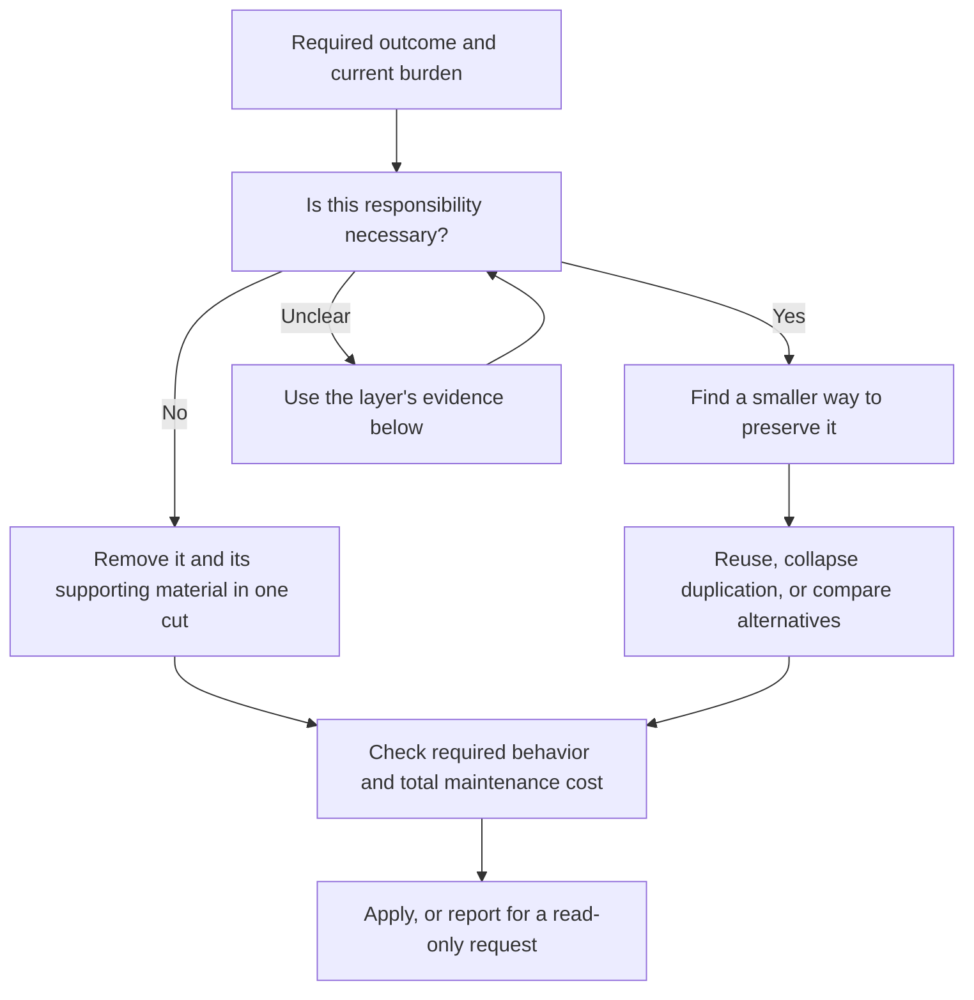

# Simplify

Reduce the total burden of delivering and maintaining the user's required outcome: code, comments, tests, fixtures, lint rules, documents, diagrams, dependencies, and workflow machinery all count. Decide first whether a responsibility is needed, then how small its implementation can be. `development-standards` owns the necessity test that every one of these artifacts passes when it is first written; this Skill applies the same test to what already exists.

## Use This Skill When

- the user names this Skill, or asks for a simplification cleanup or audit of a project, a path, or one surface such as comments or tests
- the user asks to reassess an owned architecture, replace a bespoke mechanism, or compare refactoring with rewriting; read [Structural Alternatives](references/structural-alternatives.md)

Proceed on that request only. Ordinary cleanup inside another task stays with that task under `implement-change`; a review of only a supplied diff goes to `review-change`; a material unresolved product decision goes to `design-change`.

## Scope And Authority

A cleanup request authorizes removing what the evidence supports inside the named scope; naming this Skill with no narrowing words is a cleanup request covering every layer below for the current repository. A request for an audit, an assessment, an opinion, or a structural comparison stays read-only and returns the supported cuts. Every cut rests on evidence independent of the material being cut; a candidate without that evidence stays and is reported. Apply through `implement-change`, which owns mutation, verification, conditional review, and repair.

Companion edits, such as removing a test with its code or moving a reason into a decision record, follow the request's scope and the project's write boundaries. When a needed companion edit lies outside them, keep the material and report it.

Read the project's own instructions for its source roots, protected paths, decision-record location, issue convention, and check commands, and use them as given.

Protect required outcomes, real public or persisted contracts, unique data, authorization, and current safety and recovery needs. An existing guard, audit field, parser quirk, provenance record, or compatibility branch earns protection from a consumer or boundary; general plan approval and prior test coverage leave model-invented methods revisable. Search silence alone does not prove an external consumer absent; resolve that specific uncertainty.

## Judge Each Layer Against The One Above

| Layer | Judged against | Evidence when value is unclear | Method |
| --- | --- | --- | --- |
| 1. Intent: user requirements, acceptance criteria, contracts, decision records | The user and project owner | A gap becomes an inferred record or one business question; see the next section | `organize-docs` for decision records |
| 2. Tests and fixtures | Layer 1: which required behavior does this check protect? | Break the behavior it guards and observe which checks fail; a shared failure marks a duplicate only when both checks exercise the same boundary | `testing-strategy` for suite cuts, assertions, and shared fixtures |
| 3. Code and configuration | Layer 1 and actual consumers; layer 2 verifies the removal | Bounded ablation below | `development-standards` for necessity and reuse |
| 4. Lint rules and gates | The boundary the rule names | Introduce the violation it targets and observe whether another check already reports it | Quality Gates in `development-standards` |
| 5. Source comments and explanatory documents | Layer 3 for restatement or staleness; layer 1 for a reason that already has an owner | No execution signal exists: identify the reader, the decision the text supports, and any tool that consumes it | [Source Comments](references/source-comments.md); `organize-docs` for documents |

- A lower layer shows what exists; the layer above decides whether it stays. Documents sit in two layers: those that state intent belong to layer 1, and those that restate the implementation belong to layer 5.
- Cut by responsibility. When a layer 3 responsibility goes, the tests, lint exceptions, comments, and documents that exist only for it go in the same cut.
- Keep a witness until what it witnesses is judged: a test stays while the code it verifies is under judgment, and a comment that holds the only stated reason for a choice stays until that reason has an owner.

## When A Layer Is Missing

- **Intent is unrecorded.** Agreement among code, tests, and comments shows a self-consistent implementation and serves as a working assumption about what is required. Remove exact duplicates and code that static evidence shows unreachable. Where a statement and the code contradict each other, decide which side the tests and consumers support before removing either, and report a contradiction that points at a code defect. Keep the rest, and when a non-obvious choice needs its reason preserved, record it in the project's decision owner marked as inferred from the implementation. Ask the user one business question, such as whether a behavior is still required, when that inference is the sole obstacle to a worthwhile cut.
- **Tests are missing.** Remove code where static evidence shows no reference or consumer. Where layer 1 requires a behavior and a cut depends on it, add the narrow test first.
- **No gate holds the result.** Proceed; whether a ratchet should hold a cleaned surface is the project's decision under Quality Gates in `development-standards`.

Each answered question and each inferred record enlarges what the next run can decide.

## Make The Smaller Choice Concrete

- Bound the candidate to the requested surface and name what disappears or replaces it. Inspect authored owners before generated copies.
- Use consumer evidence to separate required semantics from incidental implementation details; require exact bytes only where a real consumer or protocol needs them.
- Count replacement glue, tests, fixtures, dependencies, deployment, documentation, and maintenance to judge total system simplicity.
- Synchronize affected explanations after the implementation changes. Retain history only when it has a current reference, operational, or decision value; deletion is a valid alternative to maintaining obsolete records.

## Bounded Ablation When Value Is Unclear

Separate a concept from its representations: preserve required behavior when removing a duplicate document or generated form, and assess user value independently of helper reachability. For a read-only request, rely on existing evidence and name any experiment that would resolve remaining uncertainty. Under a cleanup request, when a candidate's value is uncertain: (1) state what user outcome or failure prevention the mechanism contributes and observe current behavior; (2) temporarily remove or bypass one coherent responsibility in a local reversible candidate using existing tests or simple commands; (3) compare required outcomes and relevant failures (and the same workload under comparable conditions when performance motivates the change); (4) keep the responsibility or choose a smaller implementation when a required result regresses, and reassess a changed incidental representation or a test of the removed mechanism against actual requirements; (5) remove temporary switches and scaffolding once their task purpose ends. Ablation supports a bounded causal conclusion under the exercised conditions; inspect rare failure modes, external clients, and trust boundaries when relevant, and obtain separate authority for destructive or production experiments. An obvious duplicated paragraph or redundant branch needs no experiment.

## Report

Report at the level the user owns: the responsibilities removed and the requirement each cut preserves, the evidence that required behavior still holds, decisions recorded as inferred, business questions still open, and what stayed because its evidence is missing. For a read-only request, lead with the strongest supported cuts, the expected maintenance reduction, and any decisive uncertainty. A justified keep or no useful cut is a valid result.
