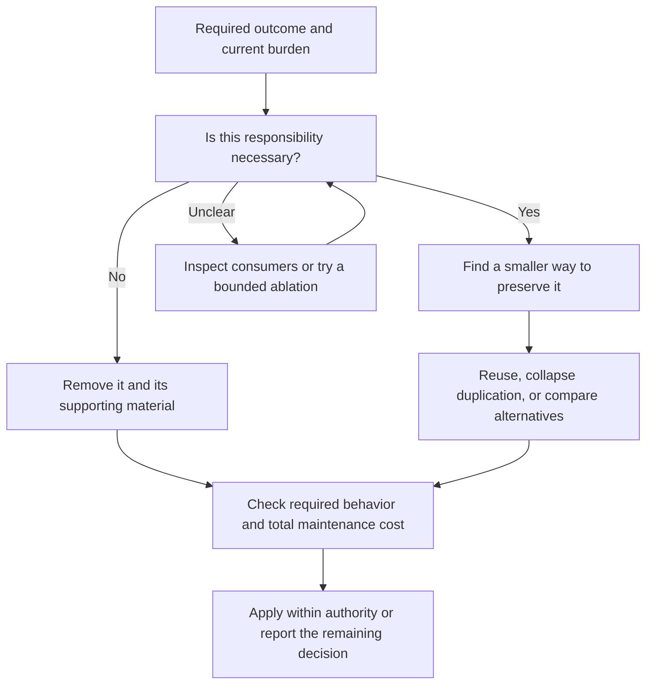

# Simplification

Read this for a requested assessment of unnecessary complexity, duplicated responsibilities, over-specified verification, or structural alternatives. Ordinary cleanup inside a task stays with that task and needs none of this.

Reduce the total burden of delivering and maintaining the user's required outcome: code, tests, fixtures, documents, diagrams, dependencies, and workflow machinery all count. Decide first whether a responsibility is needed, then how small its implementation can be; `development-standards` owns the necessity test, reuse-before-build, and the no-hashes default. An audit stays read-only. When the user also asks to simplify and the change is bounded, carry that authority into `implement-change`; a material unresolved product decision goes to `design-change`; a review of only a supplied diff stays with `review-change`.

## Choose The Relevant Surface

| Surface | Question | Method |
| --- | --- | --- |
| Code and configuration | Can a responsibility, layer, branch, compatibility path, or dependency disappear? | Current code and consumers; `development-standards` for necessity and reuse. |
| Tests and fixtures | What real behavior does each check protect, and is it covered more clearly elsewhere? | `testing-strategy` for suite cuts, assertions, and shared fixtures. |
| Documents and diagrams | What does a reader still need to understand or decide? | `organize-docs` for ownership, synchronization, and scoped retirement. |
| Architecture or bespoke framework | Would an existing capability reduce total ownership, including migration and adapters? | Structural Alternatives below. |

## Establish What Must Remain

Read the current implementation, actual consumers, and relevant user requirements. Protect required outcomes, real public or persisted contracts, unique data, authorization, and current safety and recovery needs. An existing guard, audit field, parser quirk, provenance record, or compatibility branch earns protection from a consumer or boundary; general plan approval and prior test coverage leave model-invented methods revisable. Search silence alone does not prove an external consumer absent; resolve that specific uncertainty.

## Make The Smaller Choice Concrete

- Bound the candidate to the requested surface and name what disappears or replaces it. Inspect authored owners before generated copies.
- Use consumer evidence to separate required semantics from incidental implementation details; require exact bytes only where a real consumer or protocol needs them.
- Count replacement glue, tests, fixtures, dependencies, deployment, documentation, and maintenance to judge total system simplicity.
- Synchronize affected explanations after the implementation changes. Retain history only when it has a current reference, operational, or decision value; when requested cleanup covers it, deletion is a valid alternative to maintaining obsolete records.

## Bounded Ablation When Value Is Unclear

Separate a concept from its representations: preserve required behavior when removing a duplicate document or generated form, and assess user value independently of helper reachability. For an uncertain candidate, state what user outcome or failure prevention the mechanism contributes, observe current behavior, temporarily remove or bypass one coherent responsibility in a local reversible candidate using existing tests or simple commands, compare required outcomes and relevant failures (and the same workload under comparable conditions when performance motivates the change), and interpret the difference: a regressed required result keeps the responsibility or gets a smaller implementation; a changed incidental representation or a test of the removed mechanism is reassessed against actual requirements. Ablation supports a bounded causal conclusion under the exercised conditions; inspect rare failure modes, external clients, and trust boundaries when relevant. Destructive or production experiments need their own authority; an obvious duplicated paragraph or redundant branch needs no experiment. Remove temporary switches and scaffolding once their task purpose ends.

## Structural Alternatives

For a requested reassessment of an owned architecture, replacement of a bespoke mechanism, or a refactor-versus-rewrite comparison, bound the inquiry to the requested responsibility. Identify the responsibility owned, observable behavior, consumers, data and compatibility obligations, the maintenance burden the user wants to reduce, and the declared maintenance horizon. Compare continuing the current implementation, local simplification, and a concrete mature alternative, checking the project's existing facilities and primary documentation before declaring an alternative inadequate; stop when the evidence supports a decision. Count migration, adapter glue, deployment and dependency ownership, licensing and platform constraints, verification, maintenance, and future extension; a larger one-time rewrite is justified when it removes durable responsibilities; assess sunk cost, popularity, and local line count in the full comparison. A new bespoke component names the specific gap, reliability constraint, or integration or performance advantage it answers, and the replacement's verification and recovery mechanisms justify their own cost against current risks.

## Return Or Continue

For an audit, lead with the strongest supported cuts, the requirement each preserves, the expected maintenance reduction, and any decisive uncertainty, in concise prose, a table, or a diagram. A justified keep, no useful cut, or no worthwhile replacement is a valid result. For a structural reassessment, return the bounded responsibility, verified alternative capability and gaps, retained contracts, migration consequences, expected tradeoff, uncertainties, and whether a separate design decision is needed. For authorized application, continue through `implement-change` with the bounded changes and relevant checks; an unresolved requirement gets a narrow decision, and mutation follows the user's authority or approved plan.
